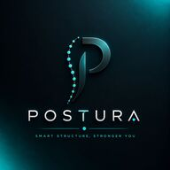

#  Postura

Postura is a premium, smart posture monitoring application built with Flutter. It connects to a hardware posture-tracking device via Bluetooth Low Energy (BLE) to provide real-time spinal alignment monitoring, historical insights, and personalized habits coaching wrapped in a stunning modern UI.

---

## ✨ Features

- 🖥️ **Real-Time Dashboard**: Monitor your current sitting/standing posture angle, deviation, and dynamic posture score in real time.
- ⚡ **Smart Calibration**: A simple calibration step when starting a session to establish your custom "good posture" baseline.
- 📡 **BLE Connection**: Seamless Bluetooth Low Energy integration powered by `flutter_blue_plus` to receive hardware sensor data.
- 🎨 **Premium Glassmorphic UI**: Beautiful light and dark themes using modern frosted glass designs, customized typography, vibrant teal gradients, and micro-animations.
- 📳 **Intelligent Alerts**: Real-time alerts (vibration and visual cues) when slouching past your configured threshold is detected.
- 📊 **History & Insights**: Track your posture scores, session durations, and slouching events over time to measure habits improvement.
- ⚙️ **Fully Customizable Settings**: Fine-tune minimum/maximum angle boundaries, slouching thresholds, notification settings, and calibration options.

---

## 🛠️ Architecture & Tech Stack

- **Frontend Framework**: [Flutter](https://flutter.dev) (Dart)
- **State Management**: [Riverpod](https://riverpod.dev) (for scalable, reactive state and clean dependency injection)
- **Routing**: [GoRouter](https://pub.dev/packages/go_router) (declarative routing with shell routes for navbar navigation)
- **Local Database**: [Hive](https://pub.dev/packages/hive) & [SharedPreferences](https://pub.dev/packages/shared_preferences) (for fast local caching of history logs and persistent user settings)
- **Hardware Communication**: [Flutter Blue Plus](https://pub.dev/packages/flutter_blue_plus) (Bluetooth Low Energy integration)

---

## 📂 Project Structure

```text
lib/
├── app/                  # Application level configurations (router, shell)
├── modules/              # Core business modules
│   ├── posture/          # BLE services, calibration flow, & state notifier
│   └── storage/          # Local database models (Hive) and preferences
├── shared/               # Shared constants, design tokens, UI components, & utilities
│   ├── components/       # Reusable templates (scaffolds) & atom UI components
│   └── constants/        # Global colors, constants, and localized strings
└── views/                # Screen-level presentation views (Home, History, Insights, Settings)
```

---

## 🚀 Getting Started

### Prerequisites

- Flutter SDK (v3.10.7 or later recommended)
- Dart SDK
- An Android or iOS device with Bluetooth capability (for BLE functions)

### Installation

1. **Clone the repository**:
   ```bash
   git clone https://github.com/bhandariprince321-netizen/postura.git
   cd postura
   ```

2. **Install dependencies**:
   ```bash
   flutter pub get
   ```

3. **Run code generation** (for Hive models):
   ```bash
   flutter pub run build_runner build --delete-conflicting-outputs
   ```

4. **Run the application**:
   ```bash
   flutter run
   ```

---

## 🔒 License

This project is licensed under the MIT License - see the LICENSE file for details.
